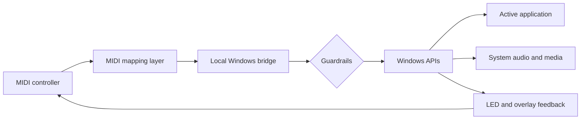

# Home Productivity

Home Productivity explores a simple idea: a physical MIDI controller can be a
fast, tactile control surface for Windows, provided every action is constrained,
observable, and reversible.

The prototype uses a Native Instruments MASCHINE MK2, but the architecture is
intended to work with any MIDI device that exposes buttons, encoders, and LEDs.

## v1 scope

The first public release is deliberately small:

- Global microphone mute with confirmed Windows state feedback
- System volume and media transport controls
- Guarded application activation without launching duplicate windows
- Scrolling and focus navigation inside the active application
- A temporary on-screen legend for the active controller page
- Debounce, duplicate-event suppression, and foreground validation

Provider-specific agent automation and personal application layouts are outside
the initial public release.

## How it fits together

The bridge is local-only. It translates allow-listed MIDI events into explicit
Windows actions; it is not a general remote-control or arbitrary-command system.
See [Architecture](architecture.md) for the component and trust boundaries.

## Design priorities

1. **Confirmed state over optimistic state.** LEDs reflect the Windows result,
   not merely the last button press.
2. **One gesture, one action.** Toggle values, release edges, aftertouch, and
   hardware chatter must not create duplicate commands.
3. **Foreground safety.** Keyboard and scrolling actions are delivered only to
   a verified target in the unchanged foreground application.
4. **Portable configuration.** Local paths, URLs, profiles, and device-specific
   templates remain outside tracked source.
5. **Useful without the cloud.** Core controls continue to work offline.

## Requirements planned for v1

- Windows 10 version 2004 or later, x64
- .NET 8 Desktop Runtime
- A Windows-compatible MIDI input device
- The device manufacturer's supported driver/editor when required
- A MIDI mapping utility capable of launching allow-listed bridge actions

## Release plan

- **Design preview:** architecture, lessons, safety model, and v1 scope
- **Configuration preview:** sanitized example mappings and setup checklist
- **v1 source:** bridge, tests, build instructions, and signed checksums

The current publication is the design preview. No private prototype history or
personal controller export is part of this repository.

## Practical notes

The prototype findings that shaped the guardrails are documented in
[Controller design notes](controller-design-notes.md).
