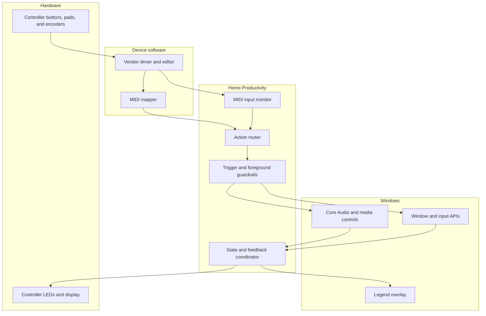
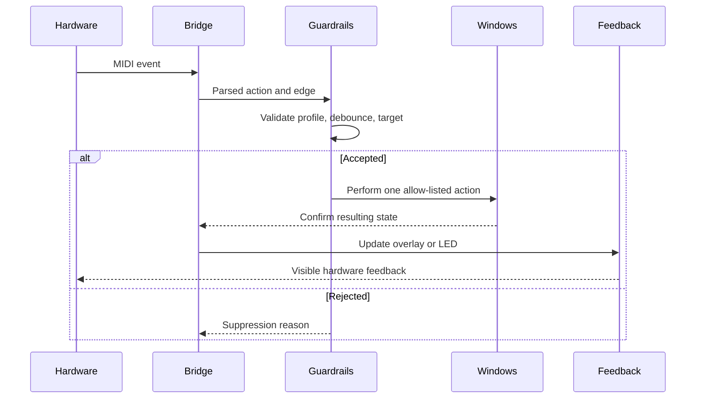

# Home Productivity architecture

## Component view

## Trust boundaries

- MIDI input is untrusted event data. Values are validated before routing.
- Mappings select only named, allow-listed actions; they do not carry arbitrary
  scripts or shell commands.
- Input delivery requires an interactive, unlocked Windows session and a stable,
  verified foreground target.
- Audio, window, and feedback state are read back from Windows before the bridge
  reports success.
- Diagnostics must omit prompt text, credentials, private URLs, and local paths.

## Action lifecycle

## Non-goals for v1

- Remote execution over the network
- Arbitrary command execution from mapping files
- Capturing application content or dictated prompts
- Bundling vendor drivers or proprietary controller templates
- Automating provider accounts or bypassing application permissions
